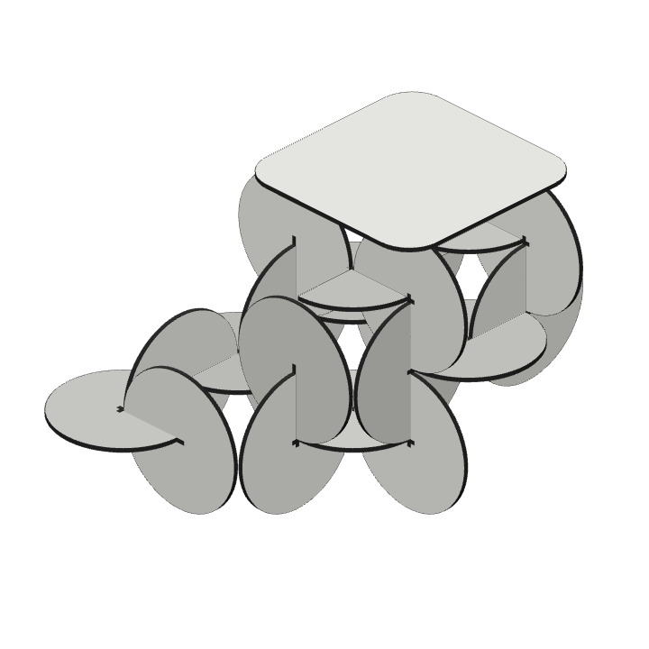
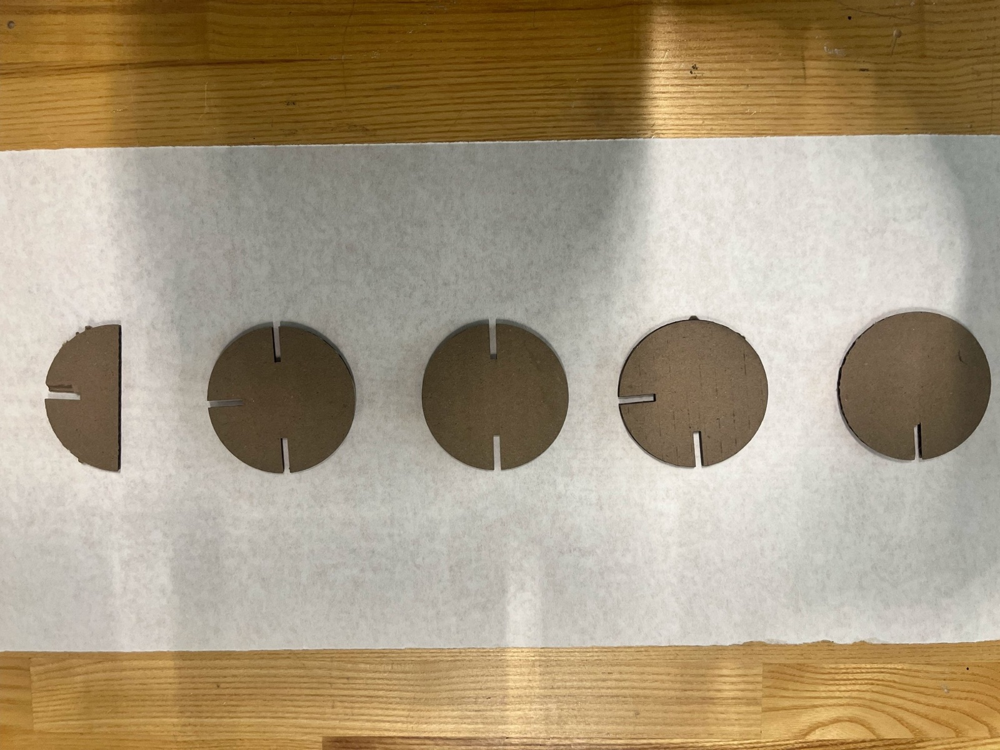
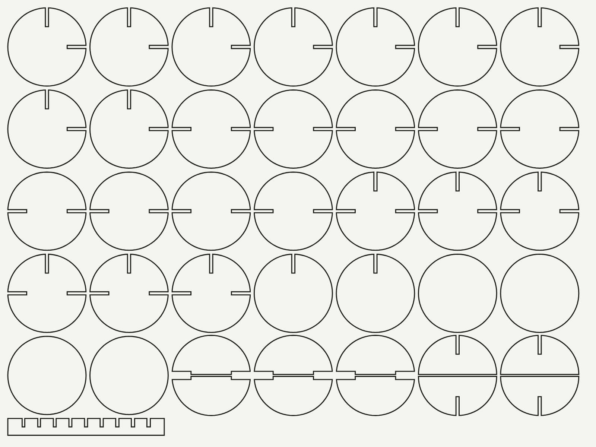
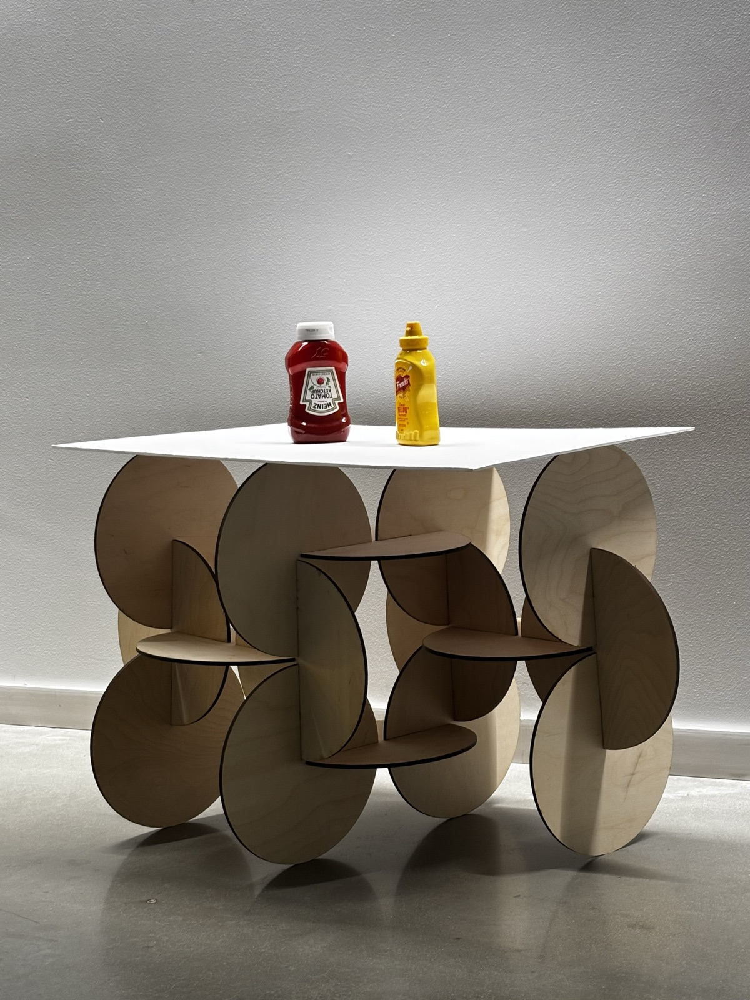
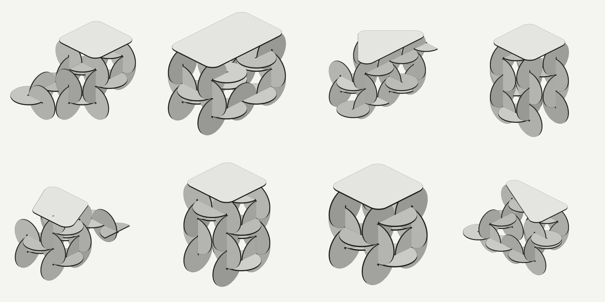
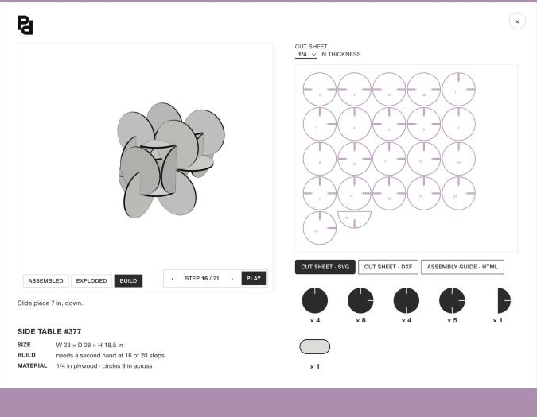
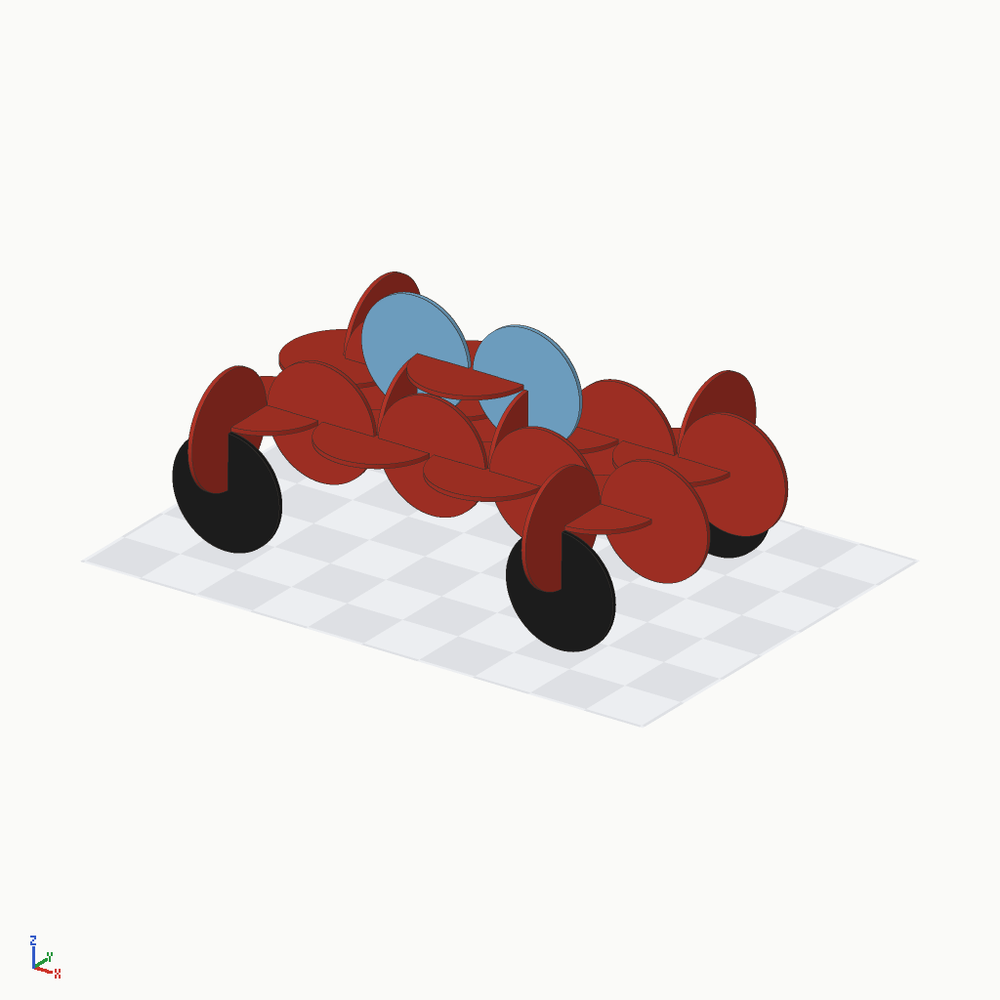
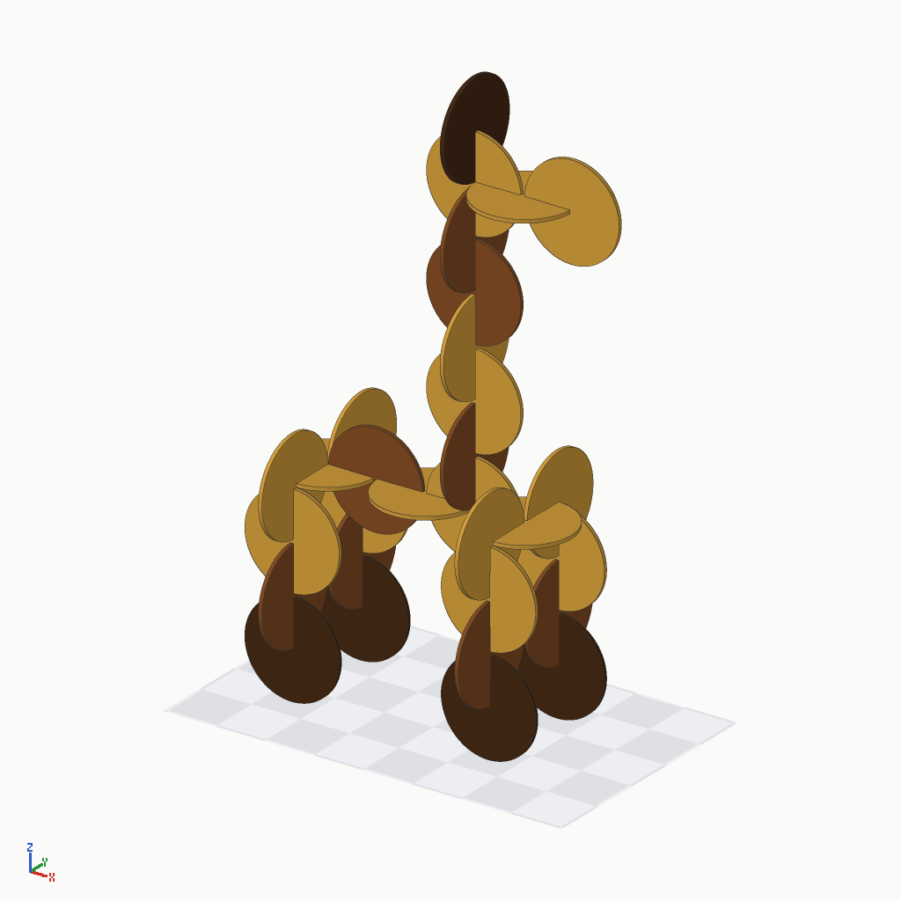
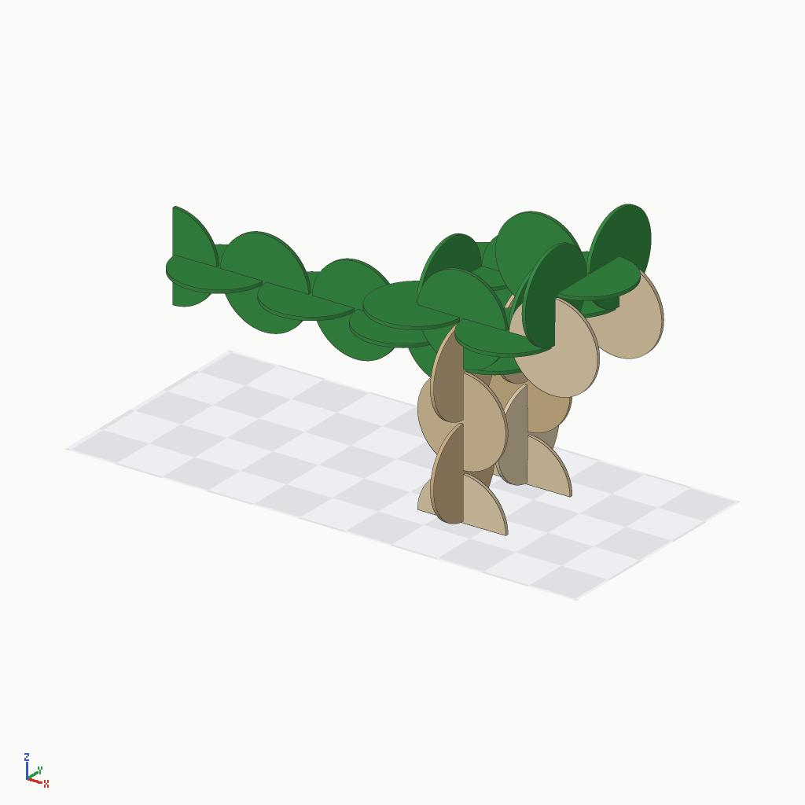

There's a reason AI has excelled at code: code is easy to verify. Write `2 + 2` in Python and you know at once whether it runs and whether you got 4. We've seen the same pattern in math, even with incredibly complex AI-generated proofs such as the recent Riemann hypothesis breakthrough.

The real world is far harder. A free-form object can't be compiled; you can't compile a pillow. There's gravity, physics and a million nuances, and it often requires human intuition. It's hard to control variables in the real world the way you can in a digital environment. So while AI has changed how we code and build digital systems, the physical world hasn't felt the same impact yet. That's the space we're exploring.

The real world and its deviations are not something to vilify. A mug with unusual curves has character. The small gaps in flooring speak to the people and stories of a home and how it was built. Our creations are as beautiful and flawed as we are. Yet, there are environments where the challenges of the physical world rear their heads. Hardware engineering is expensive, it's slow, and it often means only a small corner of the design space ever gets explored.

In code, you can ask an agent for 15 or 20 versions of a website and explore them all in parallel. Build a table or an airplane, and once you're locked in, you mostly keep adjusting that one design. There just isn't the time or money to take every variant from CAD to the wind tunnel to the physical world.

That's the question we set out to explore: how can the systems that transformed the digital world enable new kinds of creation in the physical one?

In our first experiment, we were curious about build-ability (if that's even a phrase). AI and other generative systems can produce shapes and CAD files, but they offer no guarantee that the result is structurally sound. Will it stand on its own? Will it hold a load? Can it even be assembled? AI can generate a shape in free-form space, but can you actually build it in real life?

*Side Table #377, a render from our form atlas.*

Questions about physical constraints, and about physics-informed designs meant to exist in the real world, are now front and center in research. In the last year or so, a wave of papers has looked at using these models to generate structures that both answer the prompt (or serve the structure's purpose) and are physically feasible.

One we found especially interesting was [BrickWright](https://github.com/AvaLovelace1/brickwright), which generates LEGO builds and guarantees that the structure is collision-free. Generated LEGO builds used to have overlapping bricks and other things that couldn't exist in the real world. BrickWright adds a layer on top that makes sure no two bricks intersect and that every build follows the required rules.

In a sense, it's like code: the bricks are verified, and a build that passes compiles into a real structure. But bricks only exist at toy scale. Could a limited, verified vocabulary of parts like this make useful structures, such as furniture or even buildings?

So we asked: can you generate modular furniture that is guaranteed both to answer the prompt and to be buildable?

We started by looking at a few kinds of shapes: squares, triangles and circles. We liked the idea of a small set of circles with slots, for slot-together modular furniture with no fasteners. With that as our limited vocabulary of parts, we asked whether we could generate structures such as a table or a desk.

We tried a few approaches. First, we added parts at random and checked whether the result had three points of contact for stability. Then we used algorithms like Monte Carlo tree search. We also took direct inspiration from BrickWright, where an agent builds the structure, with a physics solver on top to make sure it's realistic.

We kept playing with that, and got some interesting results and insights.

Our method started with play. Before generating anything, we wanted to see what human creativity would make with these parts. We laser-cut the simple shapes out of cardboard, started playing with them, and noticed certain forms kept appearing.

Some of them surprised us. Two pieces slotted together can rest off the usual straight-up axis, tilted, and still stand on their own. The more we played, the clearer it became that imagining larger structures out of these simple parts is hard.

We started thinking about scaling up. We used what we called our form atlas to find structures that excited us. One that stood out was a diamond-like bar table, so we scaled it up, cut it from quarter-inch plywood, and built it.

*Renders: side tables the form atlas found for 24 circles, 9 inches across.*

The build brought insights of its own. With 16 or 20 pieces, a picture of the finished table makes sense, but actually building it, navigating all the slots, is confusing. Our system built each design piece by piece and checked it, which guaranteed it could be assembled, but not that it was easy to assemble.

*Slotting plywood discs together during the build.*

Some of the generated structures needed more than one person. It was too hard to hold several parts together while sliding their slots into each other; it took more hands than one person has. That made us wonder whether we could also generate jigs from the same material: meta-process helpers that help you build the build.

*Slot Studio's build view for Side Table #377, hard to build solo.*

Overall, we were really excited. We ended up with an interesting, fun table that I could see in someone's house. But the bigger lesson was how enjoyable it is to build this way. The system takes care of the math, like the material thicknesses, and a lot of small procedural logistics that can rapidly derail a process. Those are small points beside the bigger process of creating with these shapes.

AI was an enabler of creativity, not something that took away the ability to make things. You see a shape, think "oh, I like that," and build off it. It was exciting that this was possible at all, and it opened up a lot of opportunities while leaving the creating to us.

Then we asked whether we could go further and use the kit almost like LEGO bricks. We made an agentic version that designs in a more creative, unusual space. You can see some of its results below: a car, a giraffe and a dinosaur. These are structures that would be pretty hard to imagine on your own.

The project has given us a lot of ideas for next steps.
